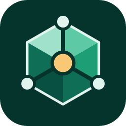

<p align="center">
  
</p>

<h1 align="center">SkillCraft</h1>

<p align="center"><b>Design, orchestrate, test and ship Agent Skills — for Claude Code, OpenAI Codex and GitHub Copilot — without leaving VS Code.</b></p>

---

SkillCraft turns VS Code into an IDE for Agent Skills (the `SKILL.md` folders that teach AI agents how to do a job). Describe what you want in chat or sketch it on a canvas; SkillCraft builds the skill with you, keeps it to best practice, tests it against real models, and packages it for every tool you use — with setup guides included.

It never changes your files on its own. Every change it suggests is a **proposal** you review as a diff and accept or reject.

## Contents

- [What you get](#what-you-get)
- [Install](#install)
- [Quick start](#quick-start)
- [The orchestrator](#the-orchestrator)
- [Working with proposals](#working-with-proposals)
- [The coach and @skillcraft chat](#the-coach-and-skillcraft-chat)
- [Health checks](#health-checks)
- [Building for Claude, Codex and Copilot](#building-for-claude-codex-and-copilot)
- [Testing](#testing)
- [Project layout](#project-layout)
- [Commands and settings](#commands-and-settings)
- [Troubleshooting](#troubleshooting)
- [Developing SkillCraft](#developing-skillcraft)

## What you get

| | |
| --- | --- |
| **Orchestrator canvas** | See and build the whole skill as a flow: entry point → inputs → sources → modules → outputs. Drag in REST or GraphQL APIs, MCP tools, local reference docs, knowledge bases, databases, files, web pages, CLIs, scripts, AI steps, conditions, loops, approvals and outputs. Not sure yet? Drop a placeholder and pick its type later. |
| **Chat-first creation** | `@skillcraft /new` interviews you one question at a time and drafts the whole skill and workflow. |
| **AI coach** | Reviews your skill, asks focused questions ("What should happen if Slack returns nothing?"), and turns your answers into proposals. *Decide for me* proposes a sensible default. |
| **Best-practice guardrails** | Live checks for structure, integrity, efficiency, portability and workflow completeness, with one-click fixes — in the Problems panel, the sidebar and on the canvas. |
| **Context budget** | See roughly how many tokens your skill costs when it's listed, when it triggers, and on demand. |
| **Any script language** | Generated scripts in Python, Node.js or Bash — switch any time. Standard library only unless a driver is unavoidable. |
| **Multi-tool builds** | One source, tailored builds for Claude Code, Codex and Copilot (or one universal build), each with `README.md`, `SETUP.md` and install scripts. |
| **Brownfield support** | Open a folder with existing skills; SkillCraft finds them, reconstructs their workflow, reports gaps and proposes fixes — without moving your files. |
| **Real testing** | Quick tests with your VS Code model (does it trigger? does it do the job?) and real agent tests through each tool's CLI. |
| **Uses your models** | Works with whatever language model you have in VS Code (for example GitHub Copilot), or your own Anthropic API key. |

## Install

**Requirements**

- VS Code 1.95 or newer (or a compatible editor such as Cursor or Windsurf)
- For AI features: a VS Code language model provider such as GitHub Copilot, **or** an Anthropic API key
- To run generated scripts: Python 3.9+, Node.js 22+, or bash + curl — whichever language you choose

**From a `.vsix` file**

```bash
code --install-extension skillcraft-0.1.0.vsix
```

Or in VS Code: Extensions view → `…` menu → **Install from VSIX…**

**From source**

```bash
cd SkillCraft            # the extension source folder
npm install
npm run package
code --install-extension skillcraft-0.1.0.vsix
```

To try it without installing, open this folder in VS Code and press **F5** (see [Developing SkillCraft](#developing-skillcraft)).

After installing, look for the **SkillCraft gem** in the activity bar on the left.

## Quick start

Open an **empty folder** in VS Code, then open the SkillCraft sidebar. Pick one of four ways to start:

1. **Describe your skill** — opens chat with `@skillcraft /new`. Answer a few questions; SkillCraft drafts the skill and shows a proposal to create it.
2. **Sketch a workflow** — name the skill, pick target tools and a script language, review the starter files, and start dragging components onto the canvas.
3. **Start from a template** — weekly status report (Jira + Slack), knowledge-base answers with citations, or a pull request digest.
4. **Import an existing skill** — analyze a skill folder you already have.

Then:

1. Fill in each component in the inspector on the right. Required fields are marked; credentials are environment variable names, never secrets.
2. Click **Sync files** to generate scripts and the workflow section of `SKILL.md`. Review the diff and accept.
3. Work through the **Checks** and **Coach** tabs until the readiness bar reaches *Runnable*.
4. Add test prompts (or ask the coach for some), click **Test**, and aim for *Tested*.
5. Click **Build**, then **Install…** — or share the `dist/` folder.

**Opening a folder that already has skills?** SkillCraft notices and offers to analyze them.

## The orchestrator

Open it from the sidebar (**Workflow**) or with **SkillCraft: Open Orchestrator**.

- **Palette (left):** every component, grouped as *Entry*, *Sources*, *Modules* and *Outputs*. Drag one onto the canvas or double-click it. Search filters the list.
- **Canvas (center):** connect components by dragging from the right handle of one to the left handle of another. Delete with Backspace. **Tidy the layout** arranges everything left to right. Colors mean the same thing everywhere: gray entry, teal sources, purple modules, coral outputs.
- **Inspector (right):** settings for the selected component, its health, which tools support it, and a **Test this source** button that calls the real endpoint and shows a sample. With nothing selected it shows the project: description, next steps, context budget, target tools and build mode.
- **Target switcher (top):** view the skill *as Claude, Codex or Copilot will see it*. Nodes a tool leaves out fade, substitutions show their replacement, and the inspector gains an **Only for <tool>** section where you can exclude a component or swap it (for example, Slack via MCP for Claude but a REST script for Codex).
- **Readiness (top):** Draft → Runnable → Tested → Ready to ship. Hover to see what's next.

**How components become a skill**

| Component | Becomes |
| --- | --- |
| Skill trigger | The `description` in `SKILL.md` ("what it does. Use when …") |
| Inputs | An *Inputs* section and script arguments |
| REST, GraphQL, knowledge base, database, files, web page, CLI | Script code in your chosen language |
| Script / Transform | A script in `scripts/` that runs its connected sources and outputs |
| MCP tool / MCP action | Instructions naming the server and tool, plus setup snippets in `SETUP.md` |
| Local reference | A file in `references/`, linked from `SKILL.md` with "read it when …" |
| AI step, condition, loop, approval, call another skill | Plain instructions in `SKILL.md` |
| File, reply in chat | Output instructions |
| Send a message, API write-back | Script code |

Generated scripts start with a `skillcraft:managed` line. Delete that line (or tick **I'll write this code myself**) and SkillCraft will never regenerate the file.

## Working with proposals

Everything SkillCraft suggests — from checks, the coach, chat, syncing or importing — arrives as a proposal:

- **Proposals view** (sidebar), grouped as *Critical*, *Recommended* and *Optional*. Each shows what changes, why, and the impact (for example "−1,400 tokens every time the skill triggers").
- **Preview** opens VS Code's diff editor (multi-file proposals open a multi-diff). Then choose **Accept** or **Reject**.
- **On the canvas**, proposed components appear as dashed green nodes with an **Accept** link.
- **Reject** asks for an optional reason and never suggests the same thing again.
- **Undo** (Proposals view title bar) reverts the last accepted proposal, including workflow changes.
- **Accept all in group** applies a whole priority group after one confirmation.

## The coach and @skillcraft chat

**Coach tab / Ask the Coach for a Review**: the coach reads your `SKILL.md`, files, workflow, check results and tests, then asks up to five questions and proposes improvements. Answer by typing, by clicking a suggested answer, or with **Decide for me**. Answers become proposals.

**Chat** (`@skillcraft` in the VS Code chat panel):

| Command | What it does |
| --- | --- |
| `/new` | Create a skill through a short conversation |
| `/review` | Run a coach review and list its questions |
| `/add` | Add a component, e.g. `/add a step that skips weekends` |
| `/explain` | Explain a warning or how the skill works |
| `/build` | Build for every target |

Free-form questions work too ("How can I make this cheaper on context?"). Suggested changes come back as **Review** buttons.

In Copilot agent mode, SkillCraft also provides two tools: **Validate skill** (`#skillcraftValidate`) and **Build skill** (`#skillcraftBuild`).

**Which model is used?** The model you picked in chat, else the `skillcraft.model` setting, else the first model VS Code offers. If none is available, SkillCraft uses your Anthropic API key (**SkillCraft: Set Anthropic API Key**, stored in VS Code secret storage) with Claude Opus 5.5.

## Health checks

Checks run on every save and show in the **Health** view, the **Problems** panel and the canvas.

| Area | Examples |
| --- | --- |
| Structure | Missing or invalid frontmatter; name not lowercase-hyphenated or not matching its folder; vague description; README or install docs inside the skill folder; scripts and docs outside `scripts/`, `references/`, `assets/` |
| Integrity | Broken links; files nothing references; hardcoded secrets; absolute paths; undeclared Python or Node dependencies; environment variables the instructions never mention |
| Efficiency | `SKILL.md` over 500 lines or ~5,000 tokens; long code blocks that should be scripts; references linking to references; long references without a table of contents |
| Portability | Frontmatter a tool ignores; descriptions over a tool's limit; components that need setup or aren't supported in a tool |
| Workflow | Placeholders, missing settings, unconfirmed inferred components, disconnected nodes, no trigger |

Most findings come with a fix proposal.

## Building for Claude, Codex and Copilot

Choose target tools and a build mode in the project panel:

- **Tailored** (default): one build per tool. Frontmatter is filtered to what each tool supports, per-tool substitutions and exclusions apply, and Codex builds get `agents/openai.yaml` with MCP dependencies.
- **Universal**: one build using only what every selected tool supports.

**Build** writes:

```
dist/
├── README.md              overview, workflow diagram, requirements, install table
├── build-report.json
├── claude/
│   ├── SETUP.md           prerequisites, credentials, MCP setup, install, verify, troubleshoot
│   ├── install.sh
│   ├── install.ps1
│   └── <skill-name>/      the ready-to-install skill
├── codex/   …
└── copilot/ …
```

**Install…** copies a build to the right place for you:

| Tool | This project | Just you |
| --- | --- | --- |
| Claude Code | `.claude/skills/<name>/` | `~/.claude/skills/<name>/` |
| OpenAI Codex | `.agents/skills/<name>/` | `~/.agents/skills/<name>/` |
| GitHub Copilot | `.github/skills/<name>/` | `~/.copilot/skills/<name>/` |

These locations come from `profiles/*.json` (verified October 2026). When a tool changes, updating its profile updates every build.

Notes in `docs/notes.md` are added to the generated README; notes in `docs/setup-<tool>.md` are added to that tool's SETUP guide. Per-tool description, extra instructions, frontmatter and file overlays (`overrides/<tool>/files/…`) are also supported — see `skillcraft.json`.

## Testing

Put test prompts in `tests/cases.json` (or ask the coach to write them):

```json
[
  { "id": "weekly-update", "prompt": "Write my weekly status update for PLAT", "shouldTrigger": true, "expect": ["shipped", "blocked"] },
  { "id": "unrelated", "prompt": "What's the capital of France?", "shouldTrigger": false }
]
```

Click **Test** and choose:

- **Quick test** — uses your AI model. Checks whether the skill would be picked over similar skills, then follows the skill and grades the answer against `expect`. Takes seconds.
- **Real agent test** — builds the skill, installs it into a temporary folder, and runs `claude`, `codex` and `copilot` headlessly for each prompt. Slower and most faithful. Agents may run the skill's scripts (and call your APIs), so SkillCraft asks first. Tools whose CLI isn't installed are reported as not tested.

Results appear in the **SkillCraft Tests** output panel and move the readiness bar.

## Project layout

```
my-skill/
├── skillcraft.json      project settings: name, targets, script language, build mode, overrides
├── workflow.json        the canvas
├── skills/<name>/       the skill source (SKILL.md, scripts/, references/, assets/)
├── overrides/<tool>/    optional per-tool files
├── tests/cases.json     test prompts
├── docs/                your notes for the generated docs
├── .skillcraft/         local state: test results, undo history (git-ignored)
└── dist/                build output (git-ignored)
```

Adopted skills stay where they are; `skillPath` in `skillcraft.json` points at them.

## Commands and settings

All commands are under **SkillCraft:** in the Command Palette.

| Command | |
| --- | --- |
| Describe Your Skill / Sketch a Workflow / Start from a Template / Import an Existing Skill | Ways to start |
| Open Orchestrator | The canvas |
| Analyze Skill Health / Ask the Coach for a Review | Checks and coaching |
| Sync Files with Workflow / Preview Generated SKILL.md | Generate files (as a proposal) / preview without writing |
| Run Skill Tests / Build Skill / Install Built Skill | Test, build, install |
| Undo Last Accepted Proposal | Undo |
| Choose AI Model / Set Anthropic API Key (fallback) | Model choice |

| Setting | Default | |
| --- | --- | --- |
| `skillcraft.model` | *(empty)* | Preferred model id; empty uses the first available |
| `skillcraft.analyzeOnSave` | `true` | Re-run checks when files change |
| `skillcraft.thresholds.skillMdLines` | `500` | Warn above this many `SKILL.md` lines |
| `skillcraft.thresholds.skillMdTokens` | `5000` | Warn above this many `SKILL.md` body tokens |

## Troubleshooting

| Problem | Fix |
| --- | --- |
| "No AI model is available" | Sign in to GitHub Copilot (or another VS Code model provider), or run **SkillCraft: Set Anthropic API Key**. Editors based on VS Code may not expose their built-in models to extensions; the API key works everywhere. |
| *Test this source* says an env var isn't set | VS Code only sees variables from the environment it started in. Export the variable in your shell and restart VS Code from that shell. |
| A file wasn't regenerated by Sync | It has no `skillcraft:managed` line, so SkillCraft treats it as yours. |
| A suggestion I rejected is gone for good | Remove its entry from `rejected` in `skillcraft.json`. |
| The skill doesn't load in my tool | Start a new agent session after installing, and follow the tool's `SETUP.md` → *Check it works*. |

## Developing SkillCraft

```bash
npm install
npm run watch        # in one terminal
```

Press **F5** and choose **Run SkillCraft (empty folder)** or **Run SkillCraft (existing skill)** — the second opens `examples/brownfield`, a deliberately messy skill, so you can watch the import and fix flow.

```bash
npm run typecheck    # extension + webview
npm test             # engine tests
npm run package      # build a .vsix
```

Architecture, conventions and how to add components, checks or target tools are in [AGENTS.md](AGENTS.md).
